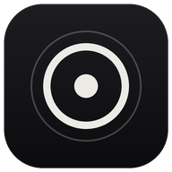
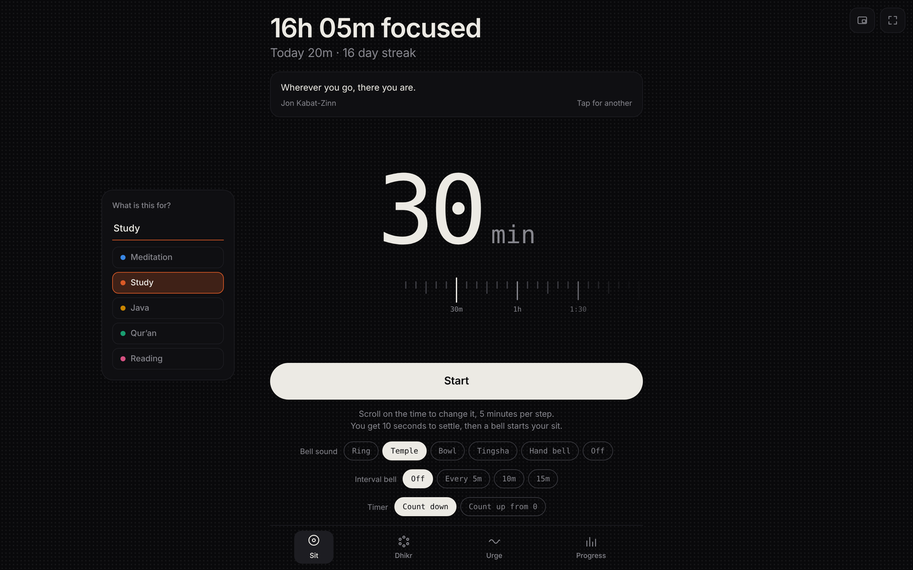
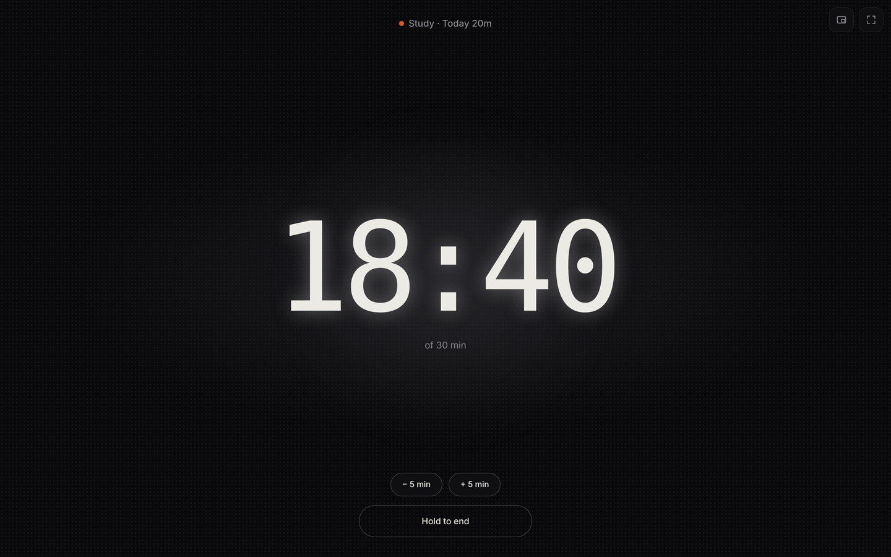
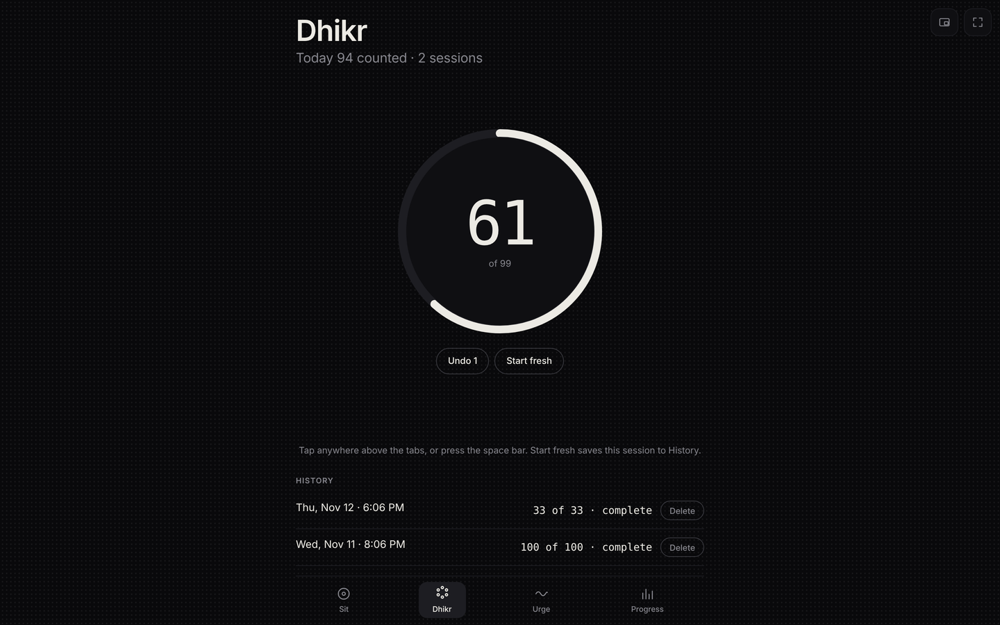
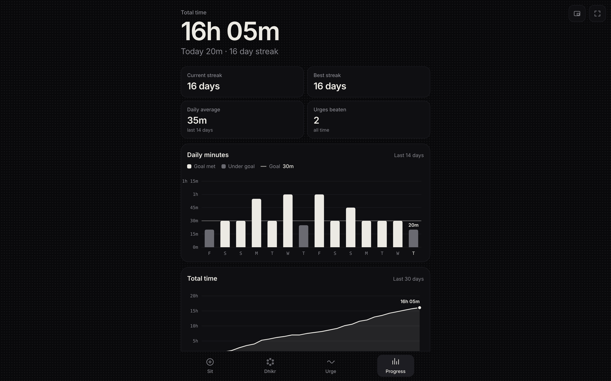

<p align="center">
  
</p>

<h1 align="center">Focus</h1>

<p align="center">
  A private, distraction-free timer for meditation, study and dhikr.<br>
  No accounts, no ads, no tracking. Your data never leaves your device.
</p>

<p align="center">
  
  
  
  
</p>

---

## Features

**Timer**
- Count down from a set time, or count up from zero.
- Labels such as Study or Meditation, each with its own color.
- Rich synthesized bells at the start and end, plus optional interval bells.
- ±5 minutes while it is running, so you never have to stop and restart.
- Overtime counts in 5-minute blocks until you press **Done**.
- Hold to end, so a stray tap can't stop a session.

**Dhikr**
- Set a goal and tap anywhere above the tabs (or press Space) to count.
- History of every session, complete or not, with delete.

**Urge**
- A short pause screen for the moment you want to open social media.

**Progress**
- Daily and weekly charts per label, plus streaks and totals.

**Wisdom**
- A new quote each time you open it: Qur'an verses (Arabic and English, fetched online) and offline quotes.

**Everywhere**
- Works offline once loaded (installable PWA).
- 12-hour time.
- Automatic local backups.

## Install

### Android tablet / phone
**[Download Focus for Android](https://github.com/AbuelgasimMohamedSaeed/Focus/releases/latest/download/Focus.apk)** (Android 11 or newer)

1. Open the link above on the tablet and download `Focus.apk`.
2. Open the file. If Android asks, allow your browser to install apps, then tap **Install**.
3. Open Focus and allow notifications.

The app adds what a website can't do:
- **Live line:** while a sit runs and Focus is closed, the time left counts down in the notification shade and on the lock screen. On Android 16 it can also show as a chip in the status bar.
- **Line at the top of the screen:** a thin line across the very top shrinks as your time runs down, over any app (needs "Display over other apps").
- **Mini window:** Focus floats over your other apps; drag it by its top bar, tap it to count Dhikr.
- **Bells with Focus closed:** the start, interval and end bells ring in the sound you chose, even with the screen off.
- **Screen stays on** while you sit with Focus open.
- **Automatic backups** to `Download › Focus backups`.
- **Updates itself:** changes to the app's screens and features arrive the next time you open it online. When a new app version is released, Focus offers to install it.

Prefer no install? Open **https://abuelgasimmohamedsaeed.github.io/Focus/** in Chrome and choose **Add to Home screen**. It works offline, but without the live line or bells while closed.

### Windows desktop
The `desktop/` folder holds an Electron shell that adds:
- a mini window;
- a tray icon;
- notifications when time is up, even with the window closed;
- a top-of-screen "island" pill that shows the time left, which you can collapse to a thin line.

```bash
cd desktop
npm install electron@33.2.1 --save-dev
npx electron .
```

## How updates work

The app is a single page hosted on GitHub Pages.
- **The app's screens and features** live on GitHub Pages. Every launch checks for a newer version first and falls back to the saved copy when offline, so pushing to `main` updates every device with no reinstall.
- **The Android app around it:** a change under `android/` makes GitHub Actions build a signed APK and publish it as a release (`app-vN`). The installed app checks the latest release and offers the update.
- **Desktop:** the Electron shell bundles its own copy today; loading the hosted version is planned.

## Privacy

- Everything you record (sessions, labels, dhikr history) is stored in the browser's `localStorage` on that device only.
- Each device keeps its own progress.
- The only network requests are:
  - Google Fonts;
  - the Qur'an verse API (`api.alquran.cloud`) for the wisdom card;
  - and, for updates, the page itself.

## Project structure

```
focus/
├── index.html              # the whole app (HTML + CSS + JS, no build step)
├── manifest.webmanifest    # PWA metadata
├── sw.js                   # service worker: offline + update strategy
├── icons/                  # app icons (PWA, maskable, Apple, Windows .ico)
├── android/                # Android app: live line, bells while closed, backups, self-update
│   └── app/src/main/java/…/focus/
│       ├── MainActivity.java   # full-screen window around the online app
│       ├── Engine.java         # alarms, live notification, time's-up alert
│       ├── BellService.java    # plays a bell while Focus is closed
│       ├── Backups.java        # Download › Focus backups
│       └── Updater.java        # checks GitHub releases and installs updates
├── .github/workflows/android.yml   # builds and releases the APK
├── desktop/                # Windows app (Electron)
│   ├── main.js             # window, tray, notifications, island, backups
│   ├── preload.js          # safe bridge between app and Electron
│   ├── island.html         # the top-of-screen pill
│   ├── island-preload.js
│   └── still.html          # bundled copy of the app
└── docs/screenshots/
```

## Roadmap

- [ ] Desktop app loads the hosted version, with an offline fallback.
- [ ] Optional export and import between devices.

## License

Personal project. All rights reserved.
